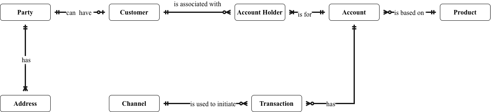
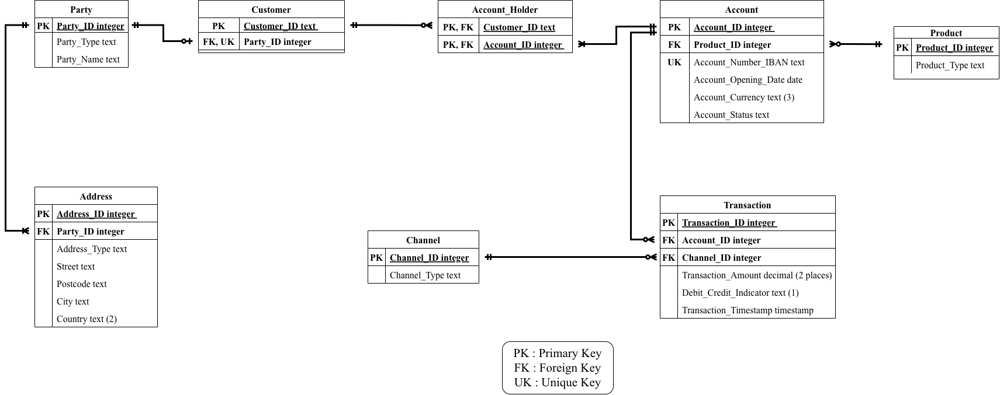

# Retail Banking Data Governance Portfolio

A business data model for retail banking, built to show how a business concept moves from an agreed definition, to a model, to a testable data quality rule, with a named owner accountable for its meaning.

**Framework:** DAMA-DMBOK (2nd edition). See the [DAMA-DMBOK alignment](#dama-dmbok-alignment) table below.

**Looking for:** data governance, data quality and data steward roles, in the Netherlands and the EU.

**Contact:** Helen Adesoba | helen.adesoba55@gmail.com | www.linkedin.com/in/helen-adesoba-900a8277

> **Read this first.** This is a learning and demonstration project. It is not based on any real bank. The Berka dataset is a public Czech bank dataset from 1999. Owners, thresholds, retention periods, severities and the policy are **assumed** and were not validated with any stakeholder.
> **Measured** means run on Berka. **Designed** means set out on paper and not operated.
> The project maps controls to the principles of BCBS 239, GDPR and Wwft (the Dutch anti-money-laundering act). Compliance is assessed on a real bank's systems and processes, so none is claimed.

## The problem

Business terms such as Customer and Account Holder are read differently across a bank, and data quality checks often cannot be traced back to an agreed meaning or an accountable owner. This project builds that chain for retail banking: from definition, to model, to testable rule, to named owner.

## Start here

| If you have | Open |
|---|---|
| 1 minute | [`portfolio/DG_Portfolio.pdf`](portfolio/DG_Portfolio.pdf), page 1 |
| 10 minutes | [`portfolio/DG_Portfolio.pdf`](portfolio/DG_Portfolio.pdf) (11 pages: front page, project at a glance, logical model, six case studies, method, reference page). The same content is in [`portfolio/DG_Portfolio.md`](portfolio/DG_Portfolio.md) |
| Time to check the work | [`project/`](project/) (full project document), [`metadata/`](metadata/) (register) and [`scripts/`](scripts/) |

## Key deliverables

- **Governance operating model:** roles, decision rights, a metadata register and a data quality scorecard. *Designed.*
- **Data issue log:** seven issues from the findings, with owner, severity and status. *Designed.*
- **Draft data quality and stewardship policy:** eight policy statements and ten controls. *Designed.*
- **BCBS 239 note:** BCBS 239 is the Basel Committee's set of principles on how banks gather, govern and report risk data. The note maps the work to them. *Designed.*
- **Data quality rules:** nine rules and two findings run on Berka. *Measured.*

## DAMA-DMBOK alignment

This project is mapped to the 11 knowledge areas of DAMA-DMBOK (2nd edition). The mapping is my own reading of the framework for this learning project. It is not a certification or a compliance claim.

| DMBOK knowledge area | Coverage | Where it is shown | Status |
|---|---|---|---|
| Data Governance | Core | Governance operating model, six stewardship roles, RACI, decision rights, escalation, scorecard with owners and thresholds (case studies 2 and 4) | Designed |
| Data Quality | Core | Profiling, nine rules (R1 to R9) and two findings (F1, F2) run on Berka, synthetic tests, scorecard (case studies 1 and 4, scripts 02 to 08) | Measured (rules), Designed (scorecard thresholds) |
| Metadata Management | Core | Business glossary (17 attributes), metadata register (30 columns), traceability from term to rule, source-to-target mapping (case study 3, `metadata/metadata_register.xlsx`) | Designed |
| Data Modelling and Design | Core | Conceptual model (8 concepts), logical model (8 tables, 30 columns, 7 foreign keys), crow's foot notation (case study 3) | Designed |
| Data Security | Partial | Data classification, retention, and mapping of controls to GDPR, Wwft and BCBS 239 (case study 5) | Designed |
| Reference and Master Data | Partial | Party, Customer and Account Holder definitions, Channel Type value list, proposed "internal posting" value | Designed |
| Data Architecture | Not covered | The model is a business and logical model, not an enterprise architecture | n/a |
| Data Integration and Interoperability | Not covered | No pipelines or integration design | n/a |
| Data Storage and Operations | Not covered | DuckDB was used for analysis only | n/a |
| Document and Content Management | Not covered | Out of scope | n/a |
| Data Warehousing and Business Intelligence | Not covered | Out of scope. This is not a data warehouse design | n/a |

## Six business needs

| # | Business need | What it shows |
|---|---|---|
| 1 | Data quality | Rules derived from definitions, and a test that zero-failure rules can detect errors |
| 2 | Ownership and stewardship | Assumed owners, six roles, RACI and a sign-off process |
| 3 | Metadata and mapping | Business, technical and operational metadata linked by attribute, and a stated Berka mapping |
| 4 | Governance operating model | Decision rights, escalation, and a scorecard with thresholds and owners |
| 5 | Policies and controls | Draft policy, ten controls, and a mapping to GDPR, Wwft and BCBS 239 |
| 6 | Data issue management | Issue lifecycle, severity targets and a log built from the findings |

Each need has a one-page case study in the portfolio, with the section of the project document it comes from.

## Data source

The public **Berka dataset**, a Czech bank dataset from 1999. Four tables were used, with these row counts:

| Table | Rows | Content |
|---|---|---|
| account | 4,500 | Accounts |
| client | 5,369 | Clients |
| disp | 5,369 | Dispositions (the link between clients and accounts, with the role OWNER or DISPONENT) |
| trans | 1,056,320 | Transactions |

Berka has dates but no times, no IBAN, no currency, and no names or addresses. Ten of the 17 glossary attributes could therefore not be tested. The data is from 1999 and says nothing about any real bank. **The Berka files are not included in this repository.** Download them yourself.

## Data transformation

- **Loaded untouched.** All four files were loaded into DuckDB as text copies (`raw_` tables), so nothing was converted or guessed on the way in and invalid values stayed visible. Raw tables were never changed.
- **Dates.** Berka dates are YYMMDD text. They were read with a stated century rule, which gives account opening dates from 1 January 1993 to 29 December 1997 and transaction dates from 1 January 1993 to 31 December 1998.
- **Direction.** Berka `type` was mapped to the Debit/Credit Indicator: PRIJEM to credit, VYDAJ to debit. The value VYBER (16,666 rows) is not documented for `type`. It is mapped to debit as a target-model decision, and still reported as a source finding (F1).
- **Channel.** Berka `operation` supplies the Channel Type values. 183,114 credits have no operation. A sixth value, "internal posting", is proposed for them (designed, awaiting owner approval).
- **Stand-ins.** `account_id` stands in for the IBAN, which Berka lacks. Only OWNER rows map to Account Holder.
- **Synthetic rows.** Labelled test rows were added to copies of the tables only, to show that rules with zero failures can detect errors. They were never counted in the results.

## Data model

An entity-relationship model for operational data, drawn in crow's foot notation. It is a business model and a logical model. It is not a data warehouse design.

- **Conceptual model:** 8 business concepts and how they relate.
- **Logical model:** 8 tables, 30 columns (17 business attributes and 13 technical key columns: 6 surrogate keys and 7 foreign keys) and 7 foreign key relationships.
- **Customer** is the established relationship of a Party. It is not a separate kind of person. **Account Holder** is a role, recorded as one record per Customer and Account.



*Conceptual model: eight business concepts and how they relate.*



*Logical model: tables, keys and relationships (8 tables, 30 columns, 7 foreign keys).*

## Skills demonstrated

| Skill | Shown in |
|---|---|
| Business glossary and definitions | Case study 2 |
| Conceptual and logical data modelling | Case study 3 |
| Data profiling | Case study 1 (Scripts 02, 03) |
| Data quality rule design and testing in SQL | Case study 1 (Scripts 04 to 08) |
| Data quality measurement and scorecard | Case study 4 |
| Metadata register and traceability from term to rule | Case study 3 |
| Source-to-target mapping | Case study 3 |
| Stewardship roles, RACI and decision rights | Case studies 2 and 4 |
| Policy and control drafting | Case study 5 |
| Data classification and retention | Case study 5 |
| Regulatory mapping: GDPR, Wwft, BCBS 239 principles | Case study 5 |
| Data issue management | Case study 6 |

**Tools:** DBeaver (SQL client) with DuckDB, and Excel for the metadata register.

## Scripts

Eight SQL scripts (DuckDB). Run them in order.

| Script | What it shows |
|---|---|
| [`01_load_raw_tables.sql`](scripts/01_load_raw_tables.sql) | Loads the four Berka files as untouched text copies and checks row counts |
| [`02_profile_transactions.sql`](scripts/02_profile_transactions.sql) | Profiles transactions before any rule is written: values, amounts, dates, identifiers |
| [`03_profile_account_client_disp.sql`](scripts/03_profile_account_client_disp.sql) | Profiles accounts, clients and dispositions |
| [`04_run_rules_store_results.sql`](scripts/04_run_rules_store_results.sql) | Runs rules R1 to R9 and findings F1 and F2, and stores the results in one table |
| [`05_synthetic_tests.sql`](scripts/05_synthetic_tests.sql) | Adds labelled synthetic rows to copies of the tables to show that zero-failure rules can detect errors |
| [`06_r6_duplicate_check.sql`](scripts/06_r6_duplicate_check.sql) | R6: transactions identical in every column except `trans_id` (potential duplicates) |
| [`07_r7_balance_reconciliation.sql`](scripts/07_r7_balance_reconciliation.sql) | R7: each balance equals the previous balance plus the signed amount |
| [`08_r8_date_validity.sql`](scripts/08_r8_date_validity.sql) | R8: dates are not in the future (a validity check; timeliness was not measured) |

**To run them:**

1. Download the Berka files (account, client, disp, trans) and put them in a folder called `data` next to `scripts`.
2. Start your SQL tool from the repository folder. The scripts use relative paths such as `data/account.asc`.
3. If your tool does not find the files, replace `data/` in Script 01 with the full path to your Berka folder.
4. Run Script 01 first. Later scripts use the tables it creates.

**Example.** Rule R2 (transaction amount is greater than zero), as an excerpt from Script 04:

```sql
-- R2: Transaction amount is greater than zero
SELECT 'R2', 'Transaction amount is greater than zero', 'Validity',
       COUNT(*),
       COUNT(*) FILTER (WHERE TRY_CAST(amount AS DECIMAL(18,2)) <= 0)
FROM raw_trans
```

**Result (measured):** 14 of 1,056,320 amounts fail (0.0013%). All 14 are zero-amount interest postings. Whether that is normal is not confirmed.

The scripts are tagged in three releases, which show how the work was built up: **v1.0** (scripts 01 to 03: load and profile), **v2.0** (scripts 04 and 05: rules and tests) and **v3.0** (scripts 06 to 08: R6, R7 and R8).

## Repository contents

```
portfolio/   DG_Portfolio.pdf            The portfolio (11 pages)
             DG_Portfolio.md             The same content, readable on GitHub
             images/                     conceptual_model.png, logical_model.png
project/     DG_Project_Portfolio.pdf    The full project document
metadata/    metadata_register.xlsx      Entities, register, 30 columns and rule results
scripts/     01 to 08 (.sql)             DuckDB scripts, run in order
```

## Decisions that shape the results

- **Customer** is the established relationship of a Party. It is not a separate kind of person. **Account Holder** is a role, recorded as one record per Customer and Account.
- Berka's VYBER value (16,666 rows) is mapped to debit as a target-model decision. It is still reported as an undocumented source value (F1).
- **R5** is a review population, not an error count. **R6** is a potential duplicate pair.
- **R8** is a validity check. Timeliness was not measured.

## Limits

Berka has no times, IBAN or currency, and one owner per account, so joint accounts are not tested. Ten of the 17 glossary attributes could not be tested on Berka. The data is from 1999 and says nothing about any real bank. Most governance controls are designed and not operated.
