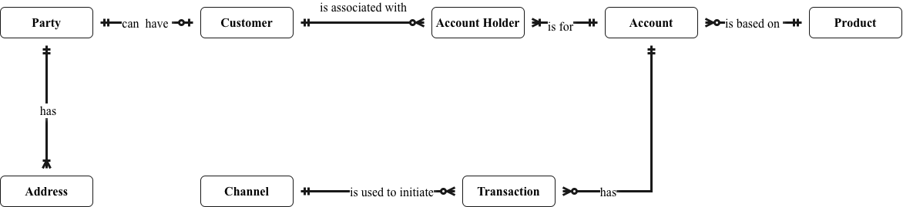
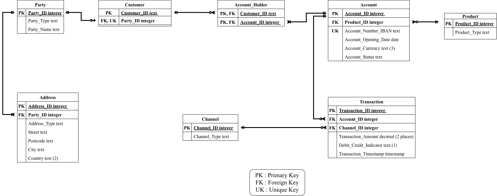

# Retail Banking Data Governance Portfolio

From an agreed definition, to a model, to a testable data quality rule, with a named owner accountable for its meaning

Helen Adesoba   |  helen.adesoba55@gmail.com   |  www.linkedin.com/in/helen-adesoba-900a8277  |  Code and data: [github.com/HelenDee-star/retail-banking-data-governance](https://github.com/HelenDee-star/retail-banking-data-governance)

Looking for: data governance, data quality and data steward roles, in the Netherlands and the EU.

### The problem

Business terms such as Customer and Account Holder are read differently across a bank, and data quality checks often cannot be traced back to an agreed meaning or an accountable owner. This project builds that chain for retail banking: from definition, to model, to testable rule, to named owner.

### The project and its key deliverables

A self-initiated business data model for retail banking, built as a learning project, with data quality rules tested on the public Berka dataset. Key deliverables:

- **Governance operating model:** roles, decision rights, a metadata register and a data quality scorecard.
- **Data issue log:** seven issues from the findings, with owner, severity and status.
- **Draft data quality and stewardship policy:** eight policy statements and ten controls.
- **BCBS 239 note:** BCBS 239 is the Basel Committee's set of principles on how banks gather, govern and report risk data. The note maps the work to them.

**Skills:** business glossary, data modelling, data profiling, data quality rules in SQL, metadata and mapping, stewardship and RACI, policy and controls, issue management, regulatory mapping (see [Project at a glance](#project-at-a-glance)). The full project document is the source for every figure in this portfolio.

### One concept, end to end: Transaction Amount

| Definition (Section 6) | Model (Sections 5, 7) | Rule (Section 9) | Measured result (Section 9) | Owner decision (11.5, designed) |
|---|---|---|---|---|
| The value of money moved, always positive. Assumed owner: Head of Payments. | Stored on Transaction as a required decimal with two places. | R2: amount is greater than zero. | 14 of 1,056,320 failed. All 14 are zero-amount interest postings. | The owner decides: correct at source, or accept as an exception. |

### Six business needs, and where each comes from

| # | Business need | What the case study shows | Project sections | Case study |
|---|---|---|---|---|
| 1 | Data quality | Rules derived from definitions, run on 1,056,320 transactions | 8, 9 | [Case study 1](#case-study-1-data-quality) |
| 2 | Ownership and stewardship | Assumed owners, six roles, RACI, sign-off process | 6, 11.1, 11.2 | [Case study 2](#case-study-2-ownership-and-stewardship) |
| 3 | Metadata and mapping | Metadata linked by attribute, and a stated Berka mapping | 3, 4, 7, 8, 11.3 | [Case study 3](#case-study-3-metadata-and-mapping) |
| 4 | Governance operating model | Decision rights, escalation, scorecard with thresholds | 11.1 to 11.5 | [Case study 4](#case-study-4-governance-operating-model) |
| 5 | Policies and controls | Draft policy, 10 controls, mapped to GDPR, Wwft (Dutch anti-money-laundering act) and BCBS 239 | 10, 11.4, 11.6, 11.8 | [Case study 5](#case-study-5-policies-and-controls) |
| 6 | Data issue management | Issue lifecycle, severity targets and a 7-issue log | 11.7 | [Case study 6](#case-study-6-data-issue-management) |

### Key figures

| Figure | Status | Sections |
|---|---|---|
| 8 entities, 17 attributes, 30 columns, 31 assumptions, 26 logged decisions | Designed | 4, 6, 7, 8 |
| 4,500 accounts, 5,369 clients and 1,056,320 transactions tested | Measured | 9 |
| 9 rules and 2 findings run. 6 zero-failure rules shown able to detect errors on synthetic rows | Measured | 9 |
| 16,666 source values that the documentation does not list under type | Measured | 9 |
| 8 policy statements, 10 controls (4 run once on Berka), 7 logged issues | Designed | 11.7, 11.8 |

> **Read this first.** This is a learning and demonstration project. It is not based on any real bank. Berka is a public Czech bank dataset from 1999. Owners, thresholds, retention periods, severities and the policy are **assumed** and were not validated with any stakeholder. **Measured** means run on Berka. **Designed** means set out on paper and not operated. The project maps controls to the principles of BCBS 239, GDPR and Wwft. Compliance is assessed on a real bank's systems and processes, so none is claimed.

---

## Project at a glance

Data source, transformation, model and skills

### Data source

The public **Berka dataset**, a Czech bank dataset from 1999. Four tables were used: account (4,500 rows), client (5,369), disposition (5,369) and transaction (1,056,320). Berka has dates but no times, no IBAN, no currency, and no names or addresses, so 10 of the 17 glossary attributes could not be tested. The data says nothing about any real bank. It is not included in the repository.

### Data transformation

- **Loaded untouched.** All four files went into DuckDB as text copies, so invalid values stayed visible. Raw tables were never changed.
- **Dates** are YYMMDD text, read with a stated century rule.
- **Direction:** type was mapped to debit or credit. VYBER (16,666 rows) is not documented for type. It is mapped to debit as a target-model decision and still reported as a source finding (F1).
- **Channel:** operation supplies the channel values. 183,114 credits have no operation. A value "internal posting" is proposed for them (designed, awaiting owner approval).
- **Stand-ins:** account_id stands in for the IBAN. Only OWNER rows map to Account Holder.
- **Synthetic rows** were added to labelled copies only, to show that zero-failure rules can detect errors. They were never counted in the results.

### Data model

An entity-relationship model for operational data, in crow's foot notation. It is a business model and a logical model, not a data warehouse design. **Customer** is the established relationship of a Party. **Account Holder** is a role, recorded as one record per Customer and Account. The logical model has 8 tables, 30 columns (17 business attributes, 6 surrogate keys and 7 foreign keys) and 7 foreign key relationships. It follows in the next section.

*Conceptual model: eight business concepts and how they relate.*

### Skills demonstrated

| Skill | Shown in | Skill | Shown in |
|---|---|---|---|
| Business glossary and definitions | Case study 2 | Data quality measurement and scorecard | Case study 4 |
| Conceptual and logical data modelling | Case study 3 | Policy and control drafting | Case study 5 |
| Data profiling | Case study 1 | Data classification and retention | Case study 5 |
| Data quality rules in SQL | Case study 1 | Regulatory mapping: GDPR, Wwft, BCBS 239 principles | Case study 5 |
| Metadata register and term-to-rule traceability | Case study 3 | Stewardship roles, RACI, decision rights | Case studies 2, 4 |
| Source-to-target mapping | Case study 3 | Data issue management | Case study 6 |

**Tools:** DBeaver (SQL client) with DuckDB, and Excel for the metadata register. **Code, scripts and register:** [github.com/HelenDee-star/retail-banking-data-governance](https://github.com/HelenDee-star/retail-banking-data-governance)

---

## Logical model

Eight tables, 30 columns and 7 foreign keys. PK = primary key, FK = foreign key, UK = unique key. Every column is required. The full-size image is in the repository under portfolio/images.

*Logical model: tables, keys and relationships (8 tables, 30 columns, 7 foreign keys).*

---

## Case study 1: Data quality

Source sections in the project document: 8 (DQ1 to DQ7), 9, Scripts 01 to 08. Codes (R, F, DQ, DI, CTL, A) are explained on the last page.

**Business need**

Data quality results that a data owner can act on, from rules that come from agreed definitions and not from whatever the dataset happens to contain.

**The problem**

A rule that finds nothing proves little. It can mean clean data, or a rule that cannot detect anything. A mapping can also make a bad source value look fine.

**What was done**

Rules R1 to R9 were written from the glossary and logical model before the data was examined. Berka was loaded into DuckDB as untouched text copies so invalid values stayed visible. Each table was profiled, each rule was run as a query, and results were reported by data quality dimension. Labelled synthetic rows were added to copies of the tables to check that zero-failure rules can detect errors. Failures, review populations and potential duplicates were kept apart.

**The artefact**

Data quality rules and results table (R1a to R9, F1, F2) and the decisions DQ1 to DQ7. Section 9 and Section 8. Eight SQL scripts.

**The evidence**

**Measured on Berka. Section 9 unless stated.**

- **R2 (amount above zero):** 14 of 1,056,320 amounts are not above zero (0.0013%). All 14 are zero-amount interest postings by k_symbol. Whether that is normal is not confirmed. Decision DQ1 keeps the rule and reports the 14. The issue is DI-02 (11.7).
- **F1 (type holds only documented values):** 16,666 rows (1.58%) hold VYBER in type. The documentation lists it only under operation. It is mapped to debit as a target-model decision (DQ2) and still reported as an undocumented source value.
- **R4 (every value maps to debit or credit) and F1 ask different questions.** R4 passes with 0 failures because the mapping covers every value. It shows the mapping is complete, not that the source is valid.
- **R7 (balance reconciles):** 5,296 of 406,941 tested balances (1.30%) do not reconcile, by 0.50 or less. Cause not established. The tested set is 38.5% of all transactions.
- **R6 (identical transactions):** one potential duplicate pair on account 9051 (trans_id 3456218 and 3507085). Amount is 0.00, so no money is affected. The data cannot show whether it is one posting recorded twice.
- **R5 (client has an owner record):** 869 of 5,369 clients (16.19%) have no OWNER record. This is a review population, not an error count. All 869 hold only the disponent role.
- **Six rules with 0 failures:** R1a and R1b (account ID unique and not empty), R3 (no transaction before account opening), R4 (see above), R8 (no future dates) and R9 (every account has an owner record). Each detected its planted error on synthetic rows (Scripts 05 and 08).
- **Timeliness was not measured.** The future-date check (R8) is a validity check, because Berka has no load or posting times (DQ6).

**The limits**

Berka has no times, IBAN or currency, so timestamp rules run at date level and 10 of the 17 glossary attributes could not be tested. Every Berka account has one OWNER, so joint accounts are never exercised. The data is from 1999 and says nothing about any real bank. Thresholds and owners are assumed.

---

## Case study 2: Ownership and stewardship

Source sections in the project document: 5, 6, 11.1, 11.2. Codes (R, F, DQ, DI, CTL, A) are explained on the last page.

**Business need**

A named role accountable for what each business term means, how good its data must be, and who may change it.

**The problem**

Without owners, terms such as Customer and Account Holder get read differently by different teams, and a quality failure has nobody to decide what to do about it.

**What was done**

A glossary was written with a definition, an assumed owner role and an example for each of 8 entities and 17 attributes. Every definition was tested against joint accounts, signatories, guarantors, prospects and customers with several accounts. Six roles were defined, owners and stewards were assigned to entities, a RACI was written with exactly one accountable role per row, and decision rights and a seven-step sign-off process were set.

**The artefact**

Business glossary (Section 6). Roles and RACI (11.1). Decision rights and sign-off (11.2).

**The evidence**

**Designed unless stated.**

- **Edge cases changed the model** (Sections 5 and 6). Account Holder was narrowed to exclude signatories and guarantors. Customer was redefined as the established relationship of a Party, not a separate kind of person or organisation.
- **Wording was reviewed in both directions** (Section 5, 11.2). "Can be a" became "can have". "Holds" became "acts as" and later "is associated with", because an Account Holder is a record of a role.
- **Five Data Owner roles cover all 8 entities** (11.1), for example Head of Payments for Transaction and Head of Account Services for Account and Account Holder. A Data Steward sits under each.
- **RACI for 10 activities**, each with exactly one accountable role (11.1). A change used by several domains goes to a governance forum (11.2).
- **Worked example** (11.2): the Account Holder narrowing, walked through the sign-off steps on paper.
- **Owners in the scorecard** (11.5): each rule is owned by the Data Owner of the attribute it tests.

**The limits**

Owner roles are assumed and described by function. They were not validated with the business. The sign-off process was not run with real stakeholders. The governance forum has no meeting schedule. All definitions are working definitions.

---

## Case study 3: Metadata and mapping

Source sections in the project document: 3, 4 (A23 to A29), 7, 8 (L1 to L9, DQ2 to DQ4), 11.3. Codes (R, F, DQ, DI, CTL, A) are explained on the last page.

**Business need**

Trace any term from its business meaning, to the column that stores it, to the quality result that tests it, and map a source system to the target model with the reasoning stated.

**The problem**

Berka does not match the model. It has no IBAN, currency, times, names or addresses, and it records direction in its own codes. A mapping choice that is not recorded becomes a hidden assumption.

**What was done**

Three kinds of metadata were produced: business (glossary), technical (logical model) and operational (rule results). They were linked by term in a metadata register kept in Excel. Every Berka mapping was stated as a numbered assumption, and each design choice was recorded with its options and trade-off.

**The artefact**

Logical model with technical metadata (Section 7). Metadata register (11.3). Berka mapping assumptions A23 to A29 (Section 4). Design decisions L1 to L9 and data quality decisions DQ2 to DQ4 (Section 8).

**The evidence**

**Designed unless stated.**

- **Logical model** (Section 7): 8 tables, 7 foreign keys, 30 columns. That is 17 business attributes plus 13 technical keys.
- **Register** (11.3): one row per term, with owner, table and column, type and key, quality rule and status. The project document shows 5 of the 17 rows.
- **Direction mapping** (assumption A25, decision DQ2): PRIJEM to credit, VYDAJ to debit, VYBER to debit. The support is that all 16,666 VYBER rows have operation VYBER, and the balance falls by exactly the amount on all 9,597 rows whose sequence position is certain (57.6%). **Measured on Berka.**
- **Stand-ins and exclusions:** account_id stands in for the IBAN (A27, DQ4). Only OWNER rows map to Account Holder (A28). Dates are held as YYMMDD text and read with a stated century rule (A29). The codes are listed on the last page.
- **Raw tables were never changed.** Synthetic rows went into labelled copies and were never counted (A30).

**The limits**

One person built the register and the owners are assumed. It holds no operational metadata about data movement, such as load logs. The VYBER mapping is an inference to be confirmed with the source owner. Ten glossary attributes have no matching Berka field.

---

## Case study 4: Governance operating model

Source sections in the project document: 11.1 to 11.5. Codes (R, F, DQ, DI, CTL, A) are explained on the last page.

**Business need**

A working structure that says who decides what, how often quality is measured, and what happens when a result misses its target.

**The problem**

Roles and rules alone do not produce decisions. A failure count needs a threshold, an owner and an escalation route before anyone can act on it.

**What was done**

The model was built in layers: roles and RACI, decision rights with sign-off and escalation, a metadata register, and a scorecard that turns the Step 4 rules into measures with a threshold, an owner and a status. The review of customers with no Account Holder was set up as a queue with its own measures, not a pass rate.

**The artefact**

Roles and RACI (11.1). Decision rights and sign-off (11.2). Metadata register (11.3). Data quality scorecard (11.5).

**The evidence**

**Measured results against assumed thresholds** (11.5, from Section 9).

- **12 scorecard lines.** 6 met the proposed threshold: account ID unique and not empty (R1a, R1b), no transaction before account opening (R3), complete direction mapping (R4), no future dates (R8) and every account has an owner record (R9). 4 did not: zero amounts (R2), identical transactions (R6), balance reconciliation (R7) and undocumented VYBER values (F1). R5 (customers with no owner record) is a review population. F2 (missing channel) measured 82.66%, and a fix is designed (decision DQ3).
- **Escalation (designed):** a result below target goes from the Data Steward to the Data Owner and is logged as an issue. Below target for two consecutive periods goes to the governance forum (proposed).
- **Review queue for customers with no owner record, R5 (designed):** measured by queue size, age of the oldest item and the share reviewed within 30 days (proposed). Baseline on Berka: 869 of 5,369 clients, all disponents, which are out of scope.
- **Role split (11.1):** the Data Owner owns the rule, Technical teams run it and the Data Steward monitors it. The Data Office checks that the process was followed and does not approve content.
- **Stated limits:** the balance rule (R7) covers 38.5% of transactions, and the future-date rule (R8) is marked "Timeliness is not measured".

**The limits**

Thresholds, the monthly frequency and the 30-day review time are proposals. The baselines come from one snapshot of a 1999 dataset, so none of them shows a trend. There is no timeliness measure. Nothing here was run with real owners.

---

## Case study 5: Policies and controls

Source sections in the project document: 10, 11.4, 11.6, 11.8. Codes (R, F, DQ, DI, CTL, A) are explained on the last page.

**Business need**

Written rules for how data is defined, owned, checked and kept, with controls that carry them out and a clear link to regulation.

**The problem**

A policy with no controls cannot be tested, and controls with no policy have no authority. A regulatory mapping is easy to overstate.

**What was done**

A data quality and stewardship policy with eight statements was drafted, each traced to a section. Ten controls (preventive, detective and corrective) were defined, with a record of what was actually done for each. The 17 attributes were classified, retention and a disposal order were assumed, and controls were mapped to GDPR, KYC/AML (Wwft) and BCBS 239.

**The artefact**

Policy and controls (11.8). Compliance and controls mapping (11.6). Lifecycle and classification (11.4). BCBS 239 mapping (Section 10).

**The evidence**

- **Eight policy statements, P1 to P8** (11.8). P5: source data is not silently changed, and a mapping records its evidence without making the source value valid. It was applied to the VYBER finding (F1, decision DQ2). P4: a rule with no failures is shown able to detect errors first.
- **Ten controls, CTL1 to CTL10, with honest status** (11.8). 4 were run or done on Berka: quality rules run against thresholds (CTL4), detection test with synthetic rows (CTL5), source-value check with recorded mapping evidence (CTL6) and the scorecard (CTL10). 6 are designed only: glossary with owners (CTL1), sign-off for changes (CTL2), structural constraints (CTL3), review of customers with no Account Holder (CTL7), issue log (CTL8) and classification, access and retention (CTL9).
- **BCBS 239 mapping** (Section 10): nine themes, each marked designed or measured. Timeliness is designed only, because Berka has no load or posting times.
- **Lifecycle and classification** (11.4, designed): retention of 5 and 7 years, simplified from commonly cited Dutch AML and tax periods, and a disposal order that follows the foreign keys (Transaction, Account Holder, Account, Customer, Address, Party).
- **GDPR, Wwft and BCBS 239 mapping** (11.6): seven requirement lines, each with a control and an assumed owner.

**The limits**

The policy is a draft with no approver, and most controls are designed and not operated. Retention periods, access roles and the classification scheme are assumed. No Compliance, Legal or Privacy function has reviewed them. Wwft details are to be confirmed with the official source. This is a mapping and does not claim compliance. BCBS 239 is about risk data, and no risk report was tested.

---

## Case study 6: Data issue management

Source sections in the project document: 11.7, 11.8 (issue log control CTL8). Codes (R, F, DQ, DI, CTL, A) are explained on the last page.

**Business need**

Every data problem has an owner, a recorded decision and a visible status, from the moment it is raised to the moment it is closed.

**The problem**

Findings in a report get forgotten. Not every finding is an error either. A review population and a potential duplicate need different handling from a failed rule.

**What was done**

What counts as an issue was defined, along with a seven-step lifecycle, three severity levels with decision targets, a RACI with one accountable role per row, and escalation triggers. An issue log was built from the Step 4 findings. The R5 review population was kept out of the log, because an item becomes an issue only if review finds the record wrong.

**The artefact**

Issue process and issue log (11.7). Issue log control CTL8 (11.8).

**The evidence**

**Designed. Statuses are proposals as at the end of the project.**

- **Seven issues logged** (11.7): DI-01 VYBER values in type (F1), 16,666 rows. DI-02 zero amounts (R2), 14 rows. DI-03 ten of those 14 labelled cash withdrawal despite an interest k_symbol, checked on 14 rows only. DI-04 the identical-transaction pair (R6). DI-05 balance differences (R7), 5,296 rows. DI-06 missing channel (F2), 183,114 rows. DI-07 Berka has one owner per account, so joint accounts are untested.
- **Status:** 5 open or awaiting a decision (DI-01 to DI-05), 1 open with a fix designed and awaiting approval (DI-06), 1 accepted (DI-07).
- **Severity (assumed):** medium for DI-01, DI-05, DI-06 (15 working days). Low for the other four (30 days or the next monthly review). None rated high.
- **Decision options for the owner:** correct at source, correct in the mapping or load, accept with a reason and a review date, change the rule or definition through sign-off, or refer to another owner.
- **Escalation to the governance forum:** past the decision target, owners disagree, or two periods below target.

**The limits**

The log was built after the fact from Step 4 findings. Owners, severities, targets and statuses are assumed, and no real owner has decided any issue. The log has no dates for each step. A real bank would keep issues in a ticketing or governance tool.

---

## How the work was done

Method, in order

The work was done in five stages. Each stage used the output of the one before. The stages were iterative: the model changed when a clean definition could not be written, and again after review.

| # | Stage | What was done |
|---|---|---|
| 1 | Conceptual model | Eight concepts were identified and every relationship was read in both directions. Two verbs that read badly were reworded. |
| 2 | Business glossary | 8 entities and 17 attributes were defined and each was tested against edge cases such as joint accounts, signatories and guarantors. |
| 3 | Logical model | Entities became tables and relationships became keys. Each design choice was logged as a decision. |
| 4 | Data quality rules | Nine rules (R1 to R9) were derived from the glossary and model and tested on Berka. Profiling added two findings: undocumented VYBER values (F1) and missing channels (F2). |
| 5 | Write-up and governance | Key decisions were recorded, the work was mapped to BCBS 239, and the governance operating model was built. |

### Working principles

- **Look before writing rules.** Each table was profiled first. This is how the undocumented VYBER value in type was found.
- **Never change the source.** Berka was loaded into DuckDB as untouched text. Test rows went into labelled copies and were never counted in the results.
- **Record every choice.** 31 numbered assumptions and 26 decisions, each with options and a trade-off.
- **State what a result establishes and what it does not.** A passing mapping rule is not a valid source. A review population is not an error count. Identical records are a potential duplicate until confirmed.
- **Show a clean result can fail.** Rules with zero failures were tested with planted errors before they were relied on.
- **Separate designed from measured.** Every claim in this portfolio carries one of the two labels.

### Tools used

DBeaver (SQL client) with DuckDB for loading, profiling and rules (eight scripts). Excel for the metadata register. Crow's foot notation for the conceptual and logical diagrams.

### Next steps

Test the rules on data with joint accounts and with times. Measure timeliness. Add reference tables, history and a customer lifecycle status. Validate roles, owners and retention periods with the business. These are the limits listed in Section 12 of the project document.

> **Limits of the whole project.** Learning project, not based on any real bank. Berka is a public dataset from 1999 and says nothing about any real bank's data quality. Owners, thresholds, retention periods, severities and the policy are assumed. Most governance controls are designed and not operated. The project maps controls to the principles of BCBS 239, GDPR and Wwft. Compliance is assessed on a real bank's systems and processes, so none is claimed.

---

## Reference: rules, findings and codes

So the case studies can be read without the project document. Results were measured on Berka (Section 9).

Rules R1 to R9 were written from the glossary before the data was examined. Findings F1 and F2 came from profiling.

| ID | What is tested | Dimension | Checked | Failed | % failed | Script |
|---|---|---|---|---|---|---|
| R1a | Account ID is unique | Uniqueness | 4,500 | 0 | 0 | 04 |
| R1b | Account ID is not empty | Completeness | 4,500 | 0 | 0 | 04 |
| R2 | Transaction amount is greater than zero | Validity | 1,056,320 | 14 | 0.0013 | 04 |
| R3 | No transaction is dated before its account opened | Consistency | 1,056,320 | 0 | 0 | 04 |
| R4 | Every source direction value maps to debit or credit | Validity (target mapping) | 1,056,320 | 0 | 0 | 04 |
| R5 | Every client has at least one OWNER record (review population, not errors) | Completeness | 5,369 | 869 flagged | 16.19 | 04 |
| R6 | No two transactions are identical except trans_id (matches are potential duplicates) | Uniqueness | 1,056,320 | 1 pair | 0.0001 | 04, 06 |
| R7 | Balance equals previous balance plus signed amount | Consistency | 406,941 | 5,296 | 1.30 | 07 |
| R8 | No date is in the future | Validity | 1,060,820 | 0 | 0 | 08 |
| R9 | Every account has at least one OWNER record | Completeness | 4,500 | 0 | 0 | 04 |
| F1 | type holds only the documented values, PRIJEM and VYDAJ | Validity (source) | 1,056,320 | 16,666 (all VYBER) | 1.58 | 04 |
| F2 | Every transaction has a channel | Completeness | 1,056,320 | 183,114 | 17.34 | 04 |

Scripts are in the repository folder scripts. Rules with zero failures were also tested on synthetic rows (Scripts 05 and 08).

### Decisions and assumptions used in the case studies

| Code | Meaning |
|---|---|
| DQ1 | Keep the rule "greater than zero" and report the 14 zero amounts as failures. |
| DQ2 | Map VYBER to debit as a target-model decision, and keep reporting it as a source finding (F1). To be confirmed with the source owner. |
| DQ3 | Add "internal posting" to the Channel Type list for credits with no operation. Designed, awaiting owner approval. |
| DQ4 | Use account_id in place of the IBAN, which Berka does not have. |
| DQ5 | Call identical transactions "potential duplicates", not duplicates. |
| DQ6 | Classify the future-date check (R8) as Validity, not Timeliness. |
| DQ7 | Compare balances exactly, with no tolerance, until an owner agrees one. |
| A4 | Every Account has at least one Account Holder record. Tested as R9. |
| A23 | Berka fields are mapped to the model. Berka has no times, IBAN, currency, names or addresses. |
| A25 | PRIJEM maps to credit and VYDAJ to debit. VYBER maps to debit only as decision DQ2. |
| A27, A28 | account_id stands in for the IBAN. Only OWNER rows map to Account Holder. |
| A29, A30 | Dates are YYMMDD text with a stated century rule. Synthetic rows only test that rules can detect errors, and are never counted. |

**Other codes.** DI = data issue (the log is in case study 6). CTL = control and P = policy statement (case study 5). C, L and DQ = modelling, logical model and data quality decisions (Section 8). A = assumption (Section 4). Berka field names (type, operation, k_symbol, trans_id) are the source dataset's own.
